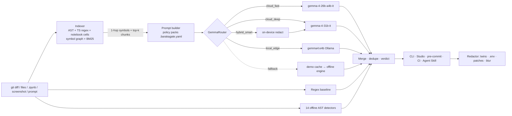

<div align="center">

# 🛡️ BarakaGate

### An open-weight pre-flight gate that stops secrets, multilingual PII and cross-file logic bugs before they leave a developer's laptop. Powered by **Gemma 4**.

**Hacktoberfest26 Rabat Hack Day** · Case 01 *Best Open-Source AI Project* · Case 02 *Best Use of Gemma 4*

`MIT` · `Python 3.10+` · `gemma-4-26b-a4b-it` · `gemma-4-31b-it` · `gemma4:e4b (Ollama)` · pre-commit · CLI · Web Studio · Agent Skill · CI

</div>

---

## 📌 Key numbers

All numbers below come from scripts in this repo; the reproduce command is next to each section.

| | Claim | Number | Evidence |
|---|---|---|---|
| 🎯 | Recall on a **held-out** benchmark, Gemma 4 26B vs. regex | **94 % [95 % CI 81–98] vs. 26 % [14–42]** | [Benchmark 2](#-benchmark-2--held-out-real-world-set-the-proof) |
| 📐 | Statistical significance (exact McNemar, paired per issue) | **24 issues only Gemma caught, 0 only regex caught · p = 1.2 × 10⁻⁷** | same |
| 🧠 | Logic & security bugs found (regex can't express these) | **12 / 13 vs. 0 / 13** | same |
| 🧩 | Edge cases designed to evade regex | **20 / 21 (95 %) vs. 0 / 21** | same |
| 🔗 | Cross-file bugs, provable only with another file's definition | **5 / 6, each citing the proving symbol** | same |
| 🖼️ | Secrets localized in screenshots (pixel IoU ≥ 0.2, no hints) | **4 / 5 regions, median IoU 0.72**; regex 0 / 5 | same |
| ⚡ | Index real open-source code (11 libraries, 1,567 files) | **598k lines in 5.3 s (112 KLOC/s)**, pure Python | [Scalability](#-scalability-on-598k-lines-of-real-open-source-code) |
| 🔎 | Context retrieval latency on that corpus | **p50 29 ms · p95 97 ms** | same |
| 🧮 | Prompt size vs. sending the whole repo | **−99.76 %** (≈12k vs. 5.2M tokens) while keeping **82 %** of cross-file callee definitions | same |
| 🔕 | Alert noise on presumed-clean production code | **0.21 heuristic alerts / KLOC** (regex 0.74) | same |
| 🔒 | Raw PII reaching the cloud in `hybrid_smart` (live test) | **0 of 4 values** | [Verification](#-verified-against-the-spec-1919) |
| 🛟 | Stage-safe fallback when cloud and Ollama are down | **served from cache, same BLOCK verdict** | same |
| ✅ | End-to-end spec checks (5 live Gemma 4) / unit tests | **19 / 19 · 104 tests in ≈1.5 s** | `scripts/verify_plan.py --live`, `pytest` |

## 1. The problem

- **Secrets keep leaking at scale.** GitGuardian found **23,770,171 new hardcoded secrets** in public GitHub commits in 2024, up 25 % year over year. **70 %** of secrets leaked in 2022 were still valid, and **35 %** of private repositories they scanned contain plaintext secrets ([GitGuardian, *State of Secrets Sprawl 2025*](https://blog.gitguardian.com/the-state-of-secrets-sprawl-2025/); [Help Net Security](https://www.helpnetsecurity.com/2025/03/19/report-the-state-of-secrets-sprawl-2025/)).
- **In Morocco, a leaked CIN or RIB is a legal liability.** Law 09-08 lets the CNDP impose fines up to **MAD 300,000**, and unlawful processing of sensitive data carries **6 months to 2 years** in prison ([CMS expert guide](https://cms.law/en/int/expert-guides/cms-expert-guide-to-data-protection-and-cyber-security-laws/morocco)). In 2025 the CNDP moved from awareness to enforcement ([Hespress](https://en.hespress.com/111530-111530.html)).
- **Existing tools look at one line at a time.** Gitleaks or Presidio regexes catch `AKIA…`. They can't see that:
  - `checkout.py` logs `customer.__dict__`, and `MoroccanCustomer`, defined in another file, holds a CIN and a RIB;
  - a payment webhook marks orders paid without calling the `verify_signature()` that already exists in `payments.py`;
  - a CIN appears inside an Arabic-script WhatsApp ticket, or an API key is visible in a terminal screenshot.

  On our held-out set the regex baseline found **0 of 13 logic bugs** and **0 of 21 edge cases**, and it fired on CIN-shaped product SKUs and `.env.example` placeholders.
- **AI assistants add a new outbound channel.** Developers paste stack traces with real customer data into cloud LLMs. That data leaves the machine before any code-review gate can catch it.

**Who it's for:**
- Moroccan fintech and e-commerce teams (CMI/Payzone, RIB, CIN, Darija support logs)
- university and research labs (CNE/Massar, HPC tokens, notebooks)
- any team that commits code or prompts cloud AI

## 2. What BarakaGate does

| | Capability | How |
|---|---|---|
| 🔴 | **Secrets & multilingual PII:** CIN, 24-digit RIB / MA IBAN, `+212` phones, CNE/Massar, CMI/Stripe/OpenAI keys, JWT/AWS, internal `*.um6p.ma` hosts, and Darija/French/Arabic free text | Regex baseline **+** Gemma 4 contextual reasoning |
| 🟣 | **Cross-file logic & security bugs:** float currency, TOCTOU double-spend, missing/timing-unsafe webhook HMAC, promo > 100 %, SQLi, off-by-one, `None` deref, missing auth, ML train/test leakage, sentinel averaging, missing seeds | Pure-Python **AST/TS chunker + symbol graph + BM25** packs the exact cross-file definitions into Gemma 4's prompt |
| 🖼️ | **Screenshots & notebook images** | Gemma 4 vision → `[ymin,xmin,ymax,xmax]` boxes → Pillow blur or solid mask |
| 🧪 | **Safe-to-Prompt firewall:** strip PII on-device, ask cloud Gemma 4, restore the values locally | Local token vault (`[CIN_TOKEN_1]`); the server refuses any prompt still containing a vault value |
| 🩹 | **Human-in-the-loop remediation:** synthetic twins (valid RIB keys / IBAN check digits), `.env` extraction, bug patches, hard mask, whitelist | Line-shift-safe patcher; all fixes apply in one pass and the patched file stays valid Python |
| 🚦 | **Gates everywhere:** git pre-commit hook, CLI (exit 1 on BLOCK), GitHub Actions PR gate, Agent Skill for coding agents, Web Studio | The same `Scanner` and `.barakagate.yaml` policy behind every gate |

## 3. How it works, and why each design choice



| Mode | Model | Where | Why |
|---|---|---|---|
| `cloud_fast` *(default)* | `gemma-4-26b-a4b-it` | Gemini API | MoE with ~3.8B active parameters. In our held-out run it answered **30/30** scans live, at 33.6 s per file on average |
| `cloud_deep` | `gemma-4-31b-it` | Gemini API | Dense model for the hardest cross-file reasoning. During our runs the free-tier endpoint answered only **4 of 9** attempts itself, and the router fell back to 26B automatically. That measurement is why 26B is the default |
| `local_edge` | `gemma4:e4b` | Ollama | **Air-gapped**: the router chain for this mode contains only `localhost:11434` (asserted in tests) |
| `hybrid_smart` | `e4b` → `31b` | local → cloud | Redact on-device, audit **sanitized** code + context in the cloud, rehydrate findings locally |

**Design decisions backed by measurements:**
- **A pure-Python index** (no FAISS/Chroma/tree-sitter) indexes **112k lines/s** and re-indexes incrementally by sha256. Nothing to compile at a hackathon or in CI.
- **A symbol graph first, BM25 second.** On real libraries, the packed context contains **82 %** of the cross-file functions a change calls, at **0.24 %** of the repo's tokens.
- **A five-step fallback chain:** requested model → other cloud model → Ollama → cached response → deterministic offline engine. Every result is labelled with the engine that actually answered, so the demo never shows an empty screen and never passes off a fallback as Gemma output.

## 4. Evidence

### 🧪 Benchmark 2 — Held-out real-world set (the proof)

A separate set of realistic mini-projects that BarakaGate's detectors and prompts were **never written against**:
- **Flask e-commerce shop** with Payzone payments, buyer fixtures and Arabic/French support tickets;
- **TypeScript/Prisma wallet** with CMI webhooks;
- **ML research lab** with Slurm jobs, a student CSV and a notebook;
- **a project that is clean on purpose**;
- **3 screenshots:** a terminal `env` dump, a specimen CIN card and a clean KPI dashboard.

It's full of edge cases: secrets split across string concatenation, RIBs in 4-digit groups, Arabic-script tickets, `%`-formatted SQLi, `===` HMAC compares, partial seeding and cross-module ML leakage. It also contains **19 false-positive traps**, such as env-read secrets, `compare_digest`, parameterized `%s`, CIN-shaped SKUs and `.env.example` placeholders.

**Protocol** (full details in [`docs/BENCHMARKS.md`](docs/BENCHMARKS.md)):
- **Labels committed first:** ground-truth labels were committed **before any engine ran** (commit `8e0758d`); the detector code is unchanged since.
- **One-to-one matching:** each finding can satisfy at most one label, and must be on the labelled line.
- **Strict precision:** any finding that matches no label counts against precision.
- **Screenshots** are scored by pixel overlap with the exact text boxes, with no offline box cache.
- **No demo cache** is used in live runs, and every fallback is reported.

<!-- REALWORLD_BENCH_START -->
**Held-out set:** 4 mini-projects (Python/Flask, TypeScript/Prisma, ML research, clean controls) · 27 files + 3 screenshots · **30 labelled issues + 5 image regions**, **19 false-positive traps**, 6 fully-clean files and 1 clean image. Ground truth was committed before any engine ran on it (`benchmarks/realworld/labels.json`).

| Engine | Leaks/PII | Logic bugs | Beyond-regex edge cases | Cross-file bugs | Screenshot regions (IoU≥0.2) | Recall | Strict precision | Traps fired | FP on clean files/image | Avg s/file |
| :--- | :-: | :-: | :-: | :-: | :-: | :-: | :-: | :-: | :-: | :-: |
| Regex baseline (Gitleaks-style) | 9/17 (53%) | 0/13 (0%) | 0/21 (0%) | 0/6 (0%) | 0/5 (0%) | **26%** | 64% | 2/19 | 3 / 0 | 0.0 |
| BarakaGate offline heuristics (no LLM) | 9/17 (53%) | 3/13 (23%) | 3/21 (14%) | 1/6 (17%) | 0/5 (0%) | **34%** | 67% | 2/19 | 3 / 0 | 0.0 |
| BarakaGate + Gemma 4 26B MoE | 17/17 (100%) | 12/13 (92%) | 20/21 (95%) | 5/6 (83%) | 4/5 (80%) | **94%** | 69% | 3/19 | 4 / 0 | 33.6 |

**Statistical confidence** (n = 35 labelled items; Wilson 95% CI on recall; exact McNemar test on paired per-item outcomes vs. the regex baseline):

| Engine | Caught | Recall [95% CI] | Only this engine caught / only regex caught | McNemar p vs regex |
| :--- | :-: | :-: | :-: | :-: |
| Regex baseline (Gitleaks-style) | 9/35 | 26% [14–42%] | — | — |
| BarakaGate offline heuristics (no LLM) | 12/35 | 34% [21–51%] | 3 / 0 | 0.250 |
| BarakaGate + Gemma 4 26B MoE | 33/35 | 94% [81–98%] | 24 / 0 | 1.2e-07 |

<details><summary><b>Per-issue results (edge-case by edge-case)</b></summary>

| ID | Edge case | Type | Regex baseline | BarakaGate offline heuristics | Gemma 4 26B MoE |
| :-: | :--- | :-: | :-: | :-: | :-: |
| S1 | Stripe live secret key hardcoded in settings | leak | ✅ | ✅ | ✅ |
| S2 | MySQL URI with inline password to an internal host | leak | ✅ | ✅ | ✅ |
| S3 | Float MAD total via `* (1 + VAT_RATE)` with the rate defined in another file and no round() call | bug | ❌ | ❌ | ✅ 🔗 |
| S4 | Refund check-then-act race across an `await` (double refund under concurrency); no `balance` naming | bug | ❌ | ❌ | ✅ |
| S5 | `vars(order.buyer)` logged; PII fields (national_id, iban, phone) only visible in models.py | leak | ❌ | ❌ | ✅ 🔗 |
| S6 | Admin state-mutating route missing @login_required used by every sibling route | bug | ❌ | ✅ | ✅ |
| S7 | Payzone notify endpoint marks orders paid without calling the existing verify_signature(); name has no 'webhook'/'callback' | bug | ❌ | ❌ | ✅ 🔗 |
| S8 | SQL injection via %-formatting (not an f-string) | bug | ❌ | ✅ | ✅ |
| S9 | Real-looking CIN inside a JSON test fixture | leak | ✅ | ✅ | ✅ |
| S10 | Moroccan IBAN printed in 4-digit groups | leak | ✅ | ✅ | ✅ |
| S11 | Phone with irregular spacing (`+212 6 61 23 45 67`) | leak | ❌ | ❌ | ✅ |
| S12 | CIN embedded in an Arabic-script Darija WhatsApp ticket | leak | ✅ | ✅ | ✅ |
| S13 | Dash-formatted phone inside Arabic text | leak | ✅ | ✅ | ✅ |
| S14 | 24-digit RIB printed in 4-digit groups (not the 3-3-16-2 layout regexes expect) | leak | ❌ | ❌ | ✅ |
| S15 | French free-text full name + home address (contextual PII, no fixed format) | leak | ❌ | ❌ | ✅ |
| T1 | CMI live key split across string concatenation to dodge regexes | leak | ❌ | ❌ | ✅ |
| T2 | OpenAI project key; no policy regex exists for this provider | leak | ❌ | ❌ | ✅ |
| T3 | TypeScript/Prisma read-check-write lost update (double spend) across awaits | bug | ❌ | ❌ | ✅ |
| T4 | JS number math for MAD + toFixed rounding | bug | ❌ | ❌ | ✅ |
| T5 | HMAC verified but compared with `===` (timing attack); a correct V2 sits right below | bug | ❌ | ❌ | ✅ |
| T6 | SQL injection through a TS template literal in $queryRawUnsafe | bug | ❌ | ❌ | ✅ |
| T7 | TS loop bound `<= length` (extra empty page) | bug | ❌ | ❌ | ✅ |
| M1 | Imputer+scaler fitted on all rows inside a helper in another module, split happens later in train.py | bug | ❌ | ❌ | ✅ 🔗 |
| M2 | Partial seeding: split is seeded, but the numpy permutation and torch init are not | bug | ❌ | ✅ 🔗 | ✅ 🔗 |
| M3 | Mean includes the -1.0 NA sentinel injected by fillna() in data.py | bug | ❌ | ❌ | ❌ |
| M4 | Student CNE + name + GPA in a CSV | leak | ✅ | ✅ | ✅ |
| M5 | Student CNE next to a counseling (health) note | leak | ✅ | ✅ | ✅ |
| M6 | Unquoted `export KEY=...` in a Slurm script (generic regex needs quotes) | leak | ❌ | ❌ | ✅ |
| M7 | Internal UM6P HPC hostname | leak | ✅ | ✅ | ✅ |
| M8 | Hugging Face token printed in a saved notebook OUTPUT cell (`!env | grep token`) | leak | ❌ | ❌ | ✅ |
| IMG1 | `terminal_env.png` — openai_api_key region | leak | ❌ | ❌ | ✅ 0.69 |
| IMG2 | `terminal_env.png` — stripe_secret_key region | leak | ❌ | ❌ | ✅ 0.76 |
| IMG3 | `cin_card.png` — name region | leak | ❌ | ❌ | ✅ 0.30 |
| IMG4 | `cin_card.png` — name region | leak | ❌ | ❌ | ❌ |
| IMG5 | `cin_card.png` — cin region | leak | ❌ | ❌ | ✅ 0.74 |

✅ caught · ❌ missed · 🔗 finding cited the cross-file symbol that proves it · image cells show IoU with the true text box.

</details>

<details><summary>Regex baseline (Gitleaks-style): 5 false positives, 0 unlabeled extra findings</summary>

- ❗ TRAP souk_shop/data/catalog.json:2 (product SKU shaped like a CIN) ← Moroccan CIN (Carte Nationale d'Identite)
- ❗ TRAP souk_shop/data/catalog.json:3 (product SKU shaped like a CIN) ← Moroccan CIN (Carte Nationale d'Identite)
- ❗ CLEAN clean_controls/.env.example:1 ← CMI / Payzone / Stripe live merchant key
- ❗ CLEAN clean_controls/.env.example:2 ← Database URI with inline password
- ❗ CLEAN clean_controls/build_info.py:5 ← Moroccan CIN (Carte Nationale d'Identite)

</details>

<details><summary>BarakaGate offline heuristics (no LLM): 5 false positives, 1 unlabeled extra findings</summary>

- ❗ TRAP souk_shop/data/catalog.json:2 (product SKU shaped like a CIN) ← Moroccan CIN (Carte Nationale d'Identite)
- ❗ TRAP souk_shop/data/catalog.json:3 (product SKU shaped like a CIN) ← Moroccan CIN (Carte Nationale d'Identite)
- ❗ CLEAN clean_controls/.env.example:1 ← CMI / Payzone / Stripe live merchant key
- ❗ CLEAN clean_controls/.env.example:2 ← Database URI with inline password
- ❗ CLEAN clean_controls/build_info.py:5 ← Moroccan CIN (Carte Nationale d'Identite)
- ❔ souk_shop/support/tickets.csv:2 — Darija / Arabic customer-support note with card & bank details

</details>

<details><summary>BarakaGate + Gemma 4 26B MoE: 7 false positives, 8 unlabeled extra findings</summary>

- ❗ TRAP souk_shop/config.py:7 (public example DSN) ← Hardcoded Sentry DSN
- ❗ TRAP souk_shop/data/catalog.json:2 (product SKU shaped like a CIN) ← Exposure of Moroccan CIN in SKU
- ❗ TRAP souk_shop/data/catalog.json:3 (product SKU shaped like a CIN) ← Exposure of Moroccan CIN in SKU
- ❗ CLEAN clean_controls/.env.example:1 ← Live Stripe Secret Key Exposed
- ❗ CLEAN clean_controls/.env.example:2 ← Database URI with Inline Password
- ❗ CLEAN clean_controls/build_info.py:5 ← Moroccan CIN (Carte Nationale d'Identite)
- ❗ CLEAN clean_controls/queries.py:9 ← Incorrect SQL placeholder for sqlite3
- ❔ oasis_ml_lab/features.py:6 — ML Train/Test Leakage via Pre-split Transformation
- ❔ oasis_ml_lab/students.csv:3 — Exposure of Sensitive Counseling Data
- ❔ souk_shop/config.py:8 — Floating Point VAT Rate
- ❔ souk_shop/models.py:19 — Use of float for currency amounts
- ❔ souk_shop/payments.py:31 — Unverified Payment Webhook Payload
- ❔ souk_shop/routes.py:8 — PII leakage via object serialization in logs
- ❔ souk_shop/routes.py:22 — Improper use of float for currency amounts
- ❔ screenshots/cin_card.png box — Date and Place of Birth

</details>

**Run notes.** BarakaGate + Gemma 4 26B MoE: 30/30 scans answered by the model (engines seen: gemini:gemma-4-26b-a4b-it); run 2026-10-24 14:40:09.

**How to read this.** *Strict precision* counts every finding that is not one of the labelled issues as a false positive, including "unlabeled extras" a reviewer might still consider valid (they're listed above for audit). *Traps* are lines that look dangerous but are correct (env-read secrets, `compare_digest`, parameterized `%s`, clamped discounts, CIN-shaped SKUs, `.env.example` placeholders, seeded RNGs, masked sentinels).

Reproduce: `python3 benchmarks/run_realworld.py --engines regex,offline,cloud_fast`.
<!-- REALWORLD_BENCH_END -->

**Reading the precision honestly.** Strict precision for Gemma 4 26B is **69 %**. Auditing the 15 non-matching findings by hand:
- **8 unlabeled extras:** 5 are real issues I didn't label:
  - the counseling (health) note in `students.csv`;
  - the date of birth on the ID card;
  - float currency in `models.py`, `config.py` and `routes.py`.

  The other 3 are duplicates of caught issues, reported at a second location.
- **7 false positives:** 5 come from the **regex layer** that BarakaGate merges in (CIN-shaped SKUs, `.env.example`, `FA20241`), not from Gemma's reasoning. One "clean" trap is actually wrong in my fixture (`%s` placeholders with `sqlite3` really do fail at runtime).

Counting the 5 real extras as correct gives an **author-adjudicated precision of 79 % (38/48)**. That figure involves my judgment; the strict 69 % does not. The obvious next step is to let Gemma veto regex hits it judges harmless, which would remove most of the remaining false positives. I deliberately did *not* tune this against the held-out set.

### ⚡ Scalability on 598k lines of real open-source code

`python3 benchmarks/scale_bench.py` copies the installed source of 11 widely used libraries into 3 cumulative tiers. For each tier it measures indexing, incremental re-indexing and retrieval. It also samples 200 real functions as "changed code" and checks whether the packed context contains the definitions of the cross-file symbols each one calls. No LLM calls are made.

| Tier | Real corpus | Files | Lines | Chunks / symbols | Cold index | Throughput | Re-index, no change | Re-index, 1 file changed | Retrieval p50 / p95 | Cross-file callee recall (cloud / local budget) | Context vs. whole repo | Regex alerts /KLOC | Heuristic alerts /KLOC |
| :-: | :--- | --: | --: | --: | --: | --: | --: | --: | --: | :-: | :-: | :-: | :-: |
| S | requests, httpx, typer, uvicorn | 97 | 28,011 | 652 / 603 | 0.18 s | 157.6 KLOC/s | 0.082 s | 0.081 s | 1.3 / 9.4 ms | 87% / 37% | ~20,594 vs ~235,818 tokens (−91.27%) | 0.321 | 0.393 |
| M | + fastapi, starlette, pydantic, rich | 384 | 137,936 | 2,780 / 2,237 | 0.87 s | 159.3 KLOC/s | 0.419 s | 0.398 s | 5.1 / 21.9 ms | 93% / 39% | ~20,026 vs ~1,213,144 tokens (−98.35%) | 0.13 | 0.245 |
| L | + google-genai, Pillow, numpy | 1,567 | 597,822 | 12,770 / 11,094 | 5.31 s | 112.5 KLOC/s | 1.991 s | 1.873 s | 29.2 / 97.2 ms | 82% / 29% | ~12,441 vs ~5,182,853 tokens (−99.76%) | 0.743 | 0.214 |

What this shows:
- **Indexing cost is close to linear.** About 4.3× more code (M → L) takes about 6× longer, still more than 100k lines/s.
- **Retrieval stays interactive.** Under 100 ms at p95, even at 600k lines.
- **Prompt cost stays roughly flat** (≈12–21k tokens) as the repo grows 21×.
- **The local-model budget is a real trade-off.** Capping context at 3 chunks / 2,500 characters for laptop inference keeps only 29–39 % of cross-file callees. That's why deep cross-file audits route to the cloud (or `hybrid_smart`).
- **Incremental re-indexing is a weak spot.** It's only about 2.8× faster than a cold index at 600k lines, because loading the 28 MB JSON index dominates. A binary or sharded index is on the roadmap.

### 🔒 Privacy measurements

| Measurement | Result | How |
|---|---|---|
| Raw values sent to the cloud in `hybrid_smart` (live Gemma 4 run, fintech scenario) | **0 / 4** (CIN, RIB, phone, CMI key) | Spy on every prompt the router sends, in `scripts/verify_plan.py --live` |
| Firewall refuses to forward a prompt still containing a vault value | **HTTP 400** | Same |
| Deterministic on-device sanitizer, held-out set (before any LLM) | **12 / 17 raw values removed (71 %)** | `python3 benchmarks/firewall_bench.py` |

The deterministic layer misses free-text names and addresses, a provider key format with no rule, 4-digit-grouped RIBs and split keys. That's exactly what the local `gemma4:e4b` pass in hybrid mode is designed to cover; its contribution is unmeasured here (Ollama was unavailable on the benchmark machine).

### ✅ Verified against the spec (19/19)

[`docs/VERIFICATION.md`](docs/VERIFICATION.md) is generated by `python3 scripts/verify_plan.py --live`. It runs 19 end-to-end checks:
- **Spec:** every required path, the `models.py` contract verbatim, and no deprecated SDK.
- **Router and indexer:** fallback chains per mode, the Ollama payload (`num_ctx` 8192, flat JSON for vision) and indexer token budgets.
- **Offline behaviour:** scans → BLOCK, CLI exit codes, all fixes applied in one pass with valid output, bbox blur touching only the boxes, the pre-commit hook blocking a CIN, and all Studio labels and REST endpoints.
- **Live Gemma 4:** a fintech scan with the `MoroccanCustomer` cross-file proof, both other scenarios, real vision localizing **4/4** secrets, hybrid mode sending **0** raw PII, and the demo-cache fallback.

<details><summary><b>📊 Benchmark 1: demo scenarios (in-distribution smoke test)</b></summary>

These are the three demo projects the Studio ships with. The offline detectors were written alongside these fixtures, so they score unrealistically well here (97 %, versus 34 % on the held-out set). That gap is exactly why Benchmark 2 exists.

| Engine | Leaks/PII caught | Logic bugs caught | Cross-file proofs | Recall | Precision | FP on clean control | Avg latency |
| :--- | :---: | :---: | :---: | :---: | :---: | :---: | :---: |
| Regex Baseline (Gitleaks-style) | 17/26 | **0/13** | 0 | 44% | 100% | 0 | 0.01s |
| BarakaGate Offline Heuristic (no LLM) | 25/26 | 13/13 | 10 | 97% | 100% | 0 | 0.01s |
| **BarakaGate + Gemma 4 26B** (`cloud_fast`) | **25/26** | **13/13** | **13** | **97%** | 96% | **0** | 39s |

In that run, 2 of 12 cases hit Gemini API errors and were answered by the offline fallback. The screenshot case's offline column uses a deterministic box cache (an upper bound, not OCR). Reproduce: `python evaluate_benchmark.py --engines regex,offline,cloud_fast`.

</details>

## 5. Threats to validity & limitations

- **Small labelled set.** 35 labelled items is small, so the confidence intervals are wide (81–98 % for Gemma). The *paired* comparison with regex is still highly significant (24 vs. 0 discordant items). Growing the set is the top roadmap item.
- **Author-built fixtures.** I wrote both the fixtures and the labels. I mitigated this by freezing labels before any run, writing natural code with no hint comments, using code shapes deliberately different from the demo samples, including 19 traps plus fully-clean files, and publishing every false positive and extra finding for audit. I didn't measure inter-annotator agreement.
- **Local and 31B engines not measured.** The `gemma4:e4b` engine wasn't benchmarked (no Ollama on the benchmark machine). The 31B run was stopped because the endpoint fell back to 26B on most calls, so I don't report a "31B" row made mostly of 26B answers.
- **LLM latency.** Gemma 4 26B through the API averages 33.6 s per file. That's fine for pre-commit on a diff or CI, but too slow to scan a whole monorepo file by file. The offline engine (73 ms per file) and the demo cache cover interactive use.
- **The regex layer limits precision.** Most remaining false positives come from regex rules BarakaGate keeps for transparency and recall. LLM-verified suppression is the planned fix.

## 6. How it scales: roadmap

1. **LLM veto of regex hits**, to cut the false positives the regex layer causes.
2. **A larger labelled corpus** (hundreds of issues, multiple annotators, real anonymized commits from partner labs), plus SARIF output for GitHub code scanning.
3. **A binary or sharded index**, so incremental re-indexing is O(changed files).
4. **Benchmarks of `gemma4:e4b` and hybrid mode on laptops**, plus a fine-tuned small model for Darija/Arabic PII.
5. **A GitHub App and org-wide policy packs** (banks, universities, hospitals) built on the same `.barakagate.yaml`.

## 7. Use it

```bash
git clone <this repo> && cd barakagate
pip install -e .                        # requires setuptools>=64; or: pip install -r requirements.txt
echo "GEMINI_API_KEY=your_key" > .env   # optional: everything also works offline
# optional, fully local: ollama pull gemma4:e4b

barakagate serve                        # → http://127.0.0.1:8000  (BarakaGate Studio)
barakagate scan samples/fintech_morocco/checkout.py --root samples/fintech_morocco -p fintech_morocco
barakagate scan samples/research_lab_um6p/train_pipeline.py --root samples/research_lab_um6p --offline
barakagate image samples/screenshots/devtools_leak.png --apply
echo "CIN BE847291 RIB 230780123456789012345678" | barakagate sanitize -
barakagate install-hook                 # pre-commit gate: blocks commits on CRITICAL/HIGH
```

Reproduce every number in this README:

```bash
python3 -m pytest -q                                              # 104 tests
python3 scripts/verify_plan.py --live                             # 19 end-to-end spec checks
python3 benchmarks/run_realworld.py --engines regex,offline,cloud_fast
python3 benchmarks/scale_bench.py                                 # 598k-line scalability run
python3 benchmarks/firewall_bench.py                              # sanitizer leak-through
python3 evaluate_benchmark.py                                     # demo-scenario smoke benchmark
```

### 🖥️ BarakaGate Studio (4 tabs)

1. **Code Diff, Leak & Logical Bug Inspector:** load a demo PR and see the retrieved cross-file context, the Regex-vs-Gemma scoreboard, the reasoning trace and a human-in-the-loop decision per finding, then preview or apply patches.
2. **Multimodal Screenshot & Notebook Image Sanitizer:** Gemma 4 vision boxes on a canvas. Click to toggle, drag to add, blur or mask, and download.
3. **Safe-to-Prompt Outbound Firewall:** sanitize locally, ask cloud Gemma 4, and restore the values automatically.
4. **Policy & Benchmark:** live-edit `.barakagate.yaml` and run the benchmark matrix.

<p align="center">
  
</p>

| Screenshot & notebook sanitizer (Gemma 4 vision boxes) | Safe-to-Prompt firewall |
|---|---|
|  |  |

### 📏 Policy-as-Code (`.barakagate.yaml`)

There are three built-in packs, which can be toggled or combined (`all`). Together they hold **15 regex rules** and **15 natural-language rules**, and the natural-language rules are injected verbatim into Gemma 4's system prompt, so teams add rules in plain English:
- **🌐 General DevSecOps:** AWS/JWT/PEM/DB-URI/internal IPs, SQLi, off-by-one, `None` deref, missing auth compared with sibling routes.
- **🇲🇦 Moroccan Fintech & E-Commerce (Law 09-08 / CNDP):** CIN, 24-digit RIB, MA IBAN, `+212` phones, Darija/French/Arabic PII, CMI/Payzone/Stripe keys, float MAD/EUR, TOCTOU, webhook HMAC, promo bypass.
- **🎓 University & Research Lab (UM6P):** CNE/Massar, `*.um6p.ma` hosts and HPC tokens, `.ipynb` output leaks, train/test leakage, sentinel/NaN values, missing seeds.

### 🤖 Agent Skill & CI

- `skills/barakagate/SKILL.md`: an Agent Skills open-standard manifest, so coding agents (Claude Code, Gemini CLI, …) run BarakaGate before committing or pasting context into cloud LLMs.
- `.github/workflows/barakagate.yml`: a PR gate that fails on `BLOCK`.
- `barakagate install-hook`: a local git pre-commit hook.

### 🗂️ Repository layout (≈7,000 lines: 14 offline detectors · 19 REST endpoints · 8 CLI commands · 4 engine modes)

```
barakagate/
  models.py          shared Pydantic contract
  config.py          .barakagate.yaml loader (+ .env)
  llm_router.py      Gemini API (26B/31B) + Ollama e4b + fallback chain + demo cache
  indexer.py         AST/TS chunker, symbol graph, BM25, notebook image extraction
  scanner.py         regex baseline + 14 AST detectors + Gemma 4 analysis, merge & verdict
  redactor.py        synthetic twins, .env extractor, patcher, image blur, prompt vault
  cli.py             Typer/Rich CLI + pre-commit hook
  server.py          FastAPI backend (19 endpoints)
  static/index.html  BarakaGate Studio
benchmarks/          held-out real-world set, scalability + firewall benchmarks, results
samples/             demo scenarios: fintech_morocco · research_lab_um6p · general_devsecops · screenshots
scripts/verify_plan.py   19-check spec verification
```

### 🔒 Privacy stance

- `local_edge` never opens a network socket other than `localhost:11434`.
- `hybrid_smart` and the firewall send only **tokenized** text; the vault stays in local memory or the browser.
- The server refuses to forward a prompt that still contains a raw vault value.

## License

MIT; see [LICENSE](LICENSE). Gemma is provided under the [Gemma Terms of Use](https://ai.google.dev/gemma/terms).
