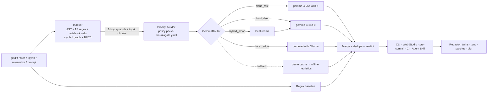
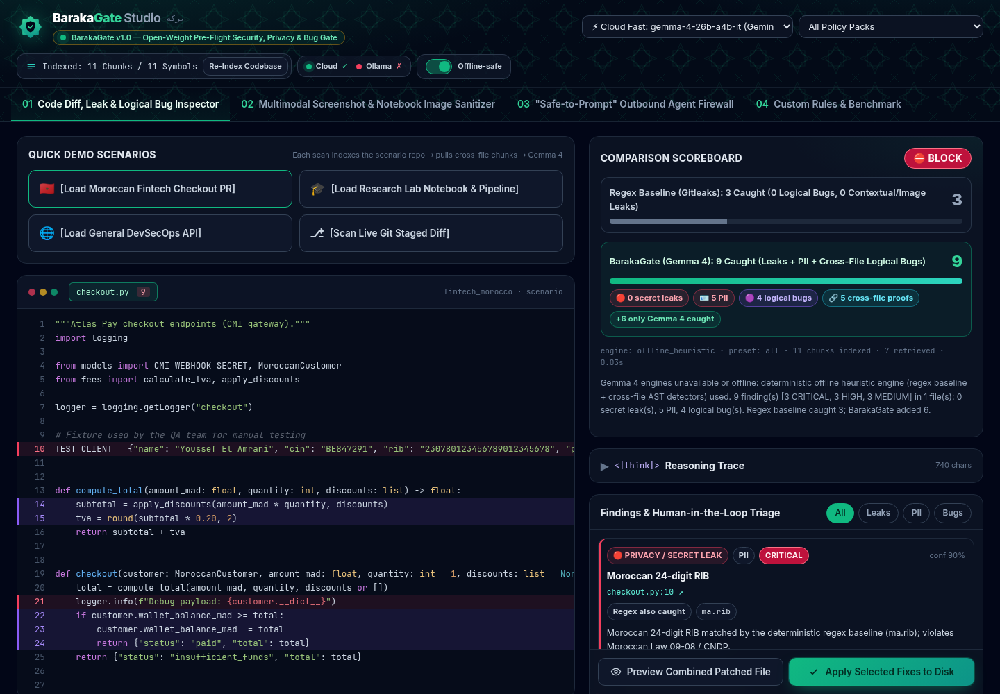
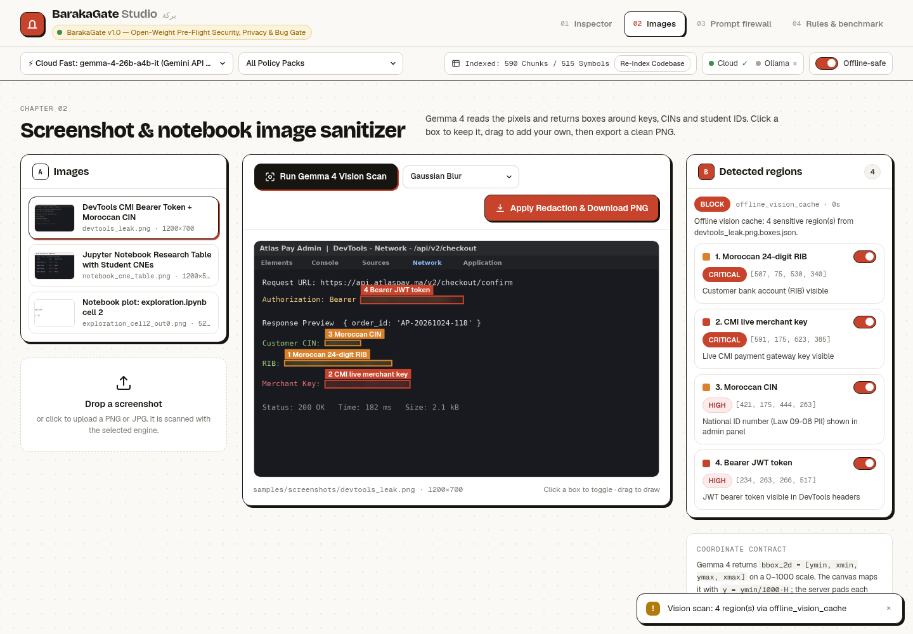
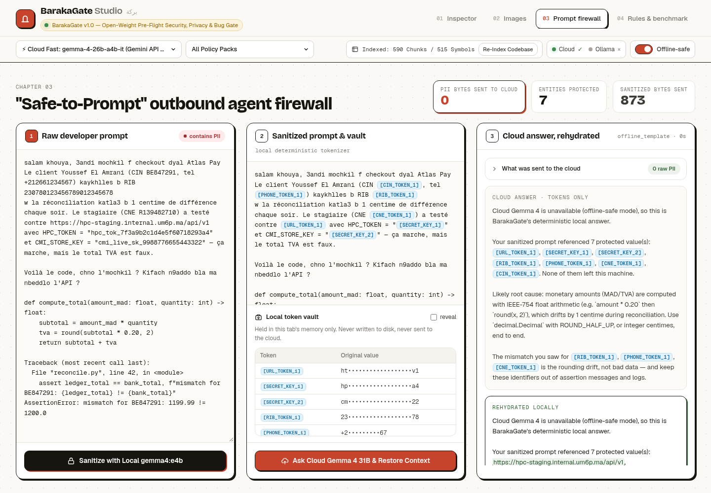

<div align="center">

# 🛡️ BarakaGate

### Open-Weight Multimodal Pre-Flight Security, Privacy & Cross-File Logical Bug Gate — powered by **Gemma 4**

**Hacktoberfest26 Rabat Hack Day** · Case 01 *Best Open-Source AI Project* · Case 02 *Best Use of Gemma 4*

`MIT` · `Python 3.10+` · `gemma-4-26b-a4b-it` · `gemma-4-31b-it` · `gemma4:e4b (Ollama)`

</div>

---

> Regex scanners like Gitleaks and Presidio catch `AKIA…`. They do **not** catch that `checkout.py` logs
> `customer.__dict__` — where `MoroccanCustomer` (defined in *another file*) holds a CIN and a 24-digit RIB.
> They do not catch a CMI payment webhook that credits a wallet **without verifying the HMAC** against a secret
> defined in `models.py`, a `float` TVA calculation drifting by one centime, a `fit_transform` before
> `train_test_split`, or a student CNE sitting inside a notebook *plot*.
>
> **BarakaGate does — before the commit, before the prompt, before the screenshot leaves your laptop.**

## ✨ What it does

| | Capability | How |
|---|---|---|
| 🔴 | **Secrets & multilingual PII** — CIN, 24-digit RIB / MA IBAN, `+212` phones, CNE/Massar, CMI/Stripe live keys, JWT/AWS, internal `*.um6p.ma` hosts, Darija / French / Arabic support logs | Regex baseline **+** Gemma 4 contextual reasoning |
| 🟣 | **Cross-file logical & security bugs** — float currency rounding, TOCTOU wallet double-spend, missing webhook HMAC, promo > 100 %, SQLi, off-by-one, `None` deref, missing auth, ML train/test leakage, sentinel `-999` averaging, missing seeds | Pure-Python **AST chunker + symbol graph + BM25** feeds the exact cross-file definitions to Gemma 4 |
| 🖼️ | **Screenshots & notebook images** — keys and CINs visible in DevTools screenshots or `.ipynb` plot outputs | Gemma 4 vision → `[ymin,xmin,ymax,xmax]` boxes → Pillow blur / solid mask |
| 🧪 | **Safe-to-Prompt firewall** — strip PII *on-device*, ask cloud Gemma 4 31B, restore context locally | Local token vault (`[CIN_TOKEN_1]` …), **0 bytes of PII sent** |
| 🩹 | **Human-in-the-loop remediation** — synthetic twins, `.env` extraction, bug patches, hard mask, whitelist | Line-shift-safe patcher, `.bak` backups |

## 🧠 Hybrid Gemma 4 routing

| Mode | Model | Where | Why |
|---|---|---|---|
| `cloud_fast` *(default)* | `gemma-4-26b-a4b-it` | Gemini API | 26B MoE, ~3.8B active → fast, 256K ctx, vision |
| `cloud_deep` | `gemma-4-31b-it` | Gemini API | 31B dense for hard cross-file reasoning |
| `local_edge` | `gemma4:e4b` | Ollama on your laptop | **100 % air-gapped**, zero bytes leave the machine |
| `hybrid_smart` | `gemma4:e4b` → `gemma-4-31b-it` | local → cloud | Redact on-device, audit **sanitized** code in the cloud, rehydrate locally |

**Never an empty screen on stage:** requested model → other cloud model → local Ollama → cached response (`.barakagate/demo_cache.json`) → deterministic **offline heuristic engine** (AST + regex detectors). Results are always labelled with the engine that actually answered.



## 🚀 Quickstart

```bash
git clone <this repo> && cd barakagate
pip install -e .                     # or: pip install -r requirements.txt
echo "GEMINI_API_KEY=your_key" > .env    # optional — everything works offline too
# optional, fully local: ollama pull gemma4:e4b

barakagate serve                     # → http://127.0.0.1:8000  (BarakaGate Studio)
barakagate scan samples/fintech_morocco/checkout.py --root samples/fintech_morocco -p fintech_morocco
barakagate scan samples/research_lab_um6p/train_pipeline.py --root samples/research_lab_um6p --offline
barakagate image samples/screenshots/devtools_leak.png --apply
echo "CIN BE847291 RIB 230780123456789012345678" | barakagate sanitize -
barakagate install-hook              # pre-commit gate: blocks commits on CRITICAL/HIGH
barakagate benchmark
```

## 🖥️ BarakaGate Studio (4 tabs)

1. **Code Diff, Leak & Logical Bug Inspector** — load a demo PR, see the *retrieved cross-file context*, Regex-vs-Gemma scoreboard, reasoning trace, and per-finding HITL decisions → preview / apply patches.
2. **Multimodal Screenshot & Notebook Image Sanitizer** — Gemma 4 vision boxes on a canvas, click to toggle, drag to add, blur or cyber-mask, download.
3. **Safe-to-Prompt Outbound Firewall** — sanitize locally → ask cloud Gemma 4 31B → auto-rehydrate.
4. **Policy & Benchmark** — live-edit `.barakagate.yaml`, run the benchmark matrix.

<p align="center">
  
</p>

| Screenshot & notebook sanitizer (Gemma 4 vision boxes) | Safe-to-Prompt firewall (0 bytes of PII to the cloud) |
|---|---|
|  |  |

## 📏 Policy-as-Code (`.barakagate.yaml`)

Three built-in packs, togglable or combined (`all`):

- **🌐 General DevSecOps** — AWS/JWT/PEM/DB-URI/internal IPs · SQLi · off-by-one · `None` deref · missing auth vs. sibling routes
- **🇲🇦 Moroccan Fintech & E-Commerce (Law 09-08 / CNDP)** — CIN · 24-digit RIB · MA IBAN · `+212` · Darija/French/Arabic PII · CMI/Payzone/Stripe keys · float MAD/EUR · TOCTOU · webhook HMAC · promo bypass
- **🎓 University & Research Lab (UM6P)** — CNE/Massar · `*.um6p.ma` / HPC tokens · `.ipynb` output leaks · train/test leakage · sentinel/NaN · missing seeds

Each pack has **regex rules** (deterministic baseline) and **natural-language rules** injected into Gemma 4's system prompt — teams add their own in plain English.

## 📊 Benchmark — Regex vs. Gemma 4

12 labelled cases · 39 planted issues (26 leaks/PII + 13 logical bugs) · 1 clean negative control
(ground truth: [`samples/expected_findings.json`](samples/expected_findings.json)).

| Engine | Leaks/PII caught | Logic bugs caught | Cross-file proofs | Recall | Precision | FP on clean control | Avg latency |
| :--- | :---: | :---: | :---: | :---: | :---: | :---: | :---: |
| Regex Baseline (Gitleaks-style) | 17/26 | **0/13** | 0 | 44% | 100% | 0 | 0.01s |
| BarakaGate Offline Heuristic (no LLM) | 25/26 | 13/13 | 10 | 97% | 100% | 0 | 0.01s |
| **BarakaGate + Gemma 4 26B** (`cloud_fast`) | **25/26** | **13/13** | **13** | **97%** | 96% | **0** | 39s |
| BarakaGate + Gemma 4 E4B (`local_edge`) | n/a — Ollama not installed on the benchmark machine | | | | | | |

| # | Case | Regex | Offline | Gemma 4 26B |
| :-: | :--- | :---: | :---: | :---: |
| 1 | Fintech checkout (PII fixture + cross-file bugs) | 3/9 | 9/9 | 9/9 |
| 2 | Fintech models (CMI live key) | 2/2 | 2/2 | 2/2 |
| 3 | Fintech fees (float MAD + promo bypass) | 0/2 | 2/2 | 2/2 |
| 4 | Lab loader (student CNEs) | 2/2 | 2/2 | 2/2 † |
| 5 | Lab train pipeline (ML leakage, seed, sentinel) | 0/3 | 3/3 | 3/3 † |
| 6 | Lab config (HPC token, internal host) | 2/2 | 2/2 | 2/2 |
| 7 | Lab notebook (.ipynb output leak) | 1/2 | 2/2 | 2/2 |
| 8 | DevSecOps API (SQLi, off-by-one, auth, None) | 0/4 | 4/4 | 4/4 |
| 9 | DevSecOps settings (JWT, AWS, DB URI) | 4/5 | 4/5 | 4/5 |
| 10 | Darija support log (multilingual PII) | 3/4 | 4/4 | 4/4 |
| 11 | DevTools screenshot (vision OCR + bbox) | 0/4 | 4/4 ‡ | 4/4 |
| 12 | Clean pricing module (negative control) | PASS | PASS | PASS |

**Honest notes.** † In the live run (2026-10-24), these two cases hit Gemini API errors/timeouts and were answered by the automatic offline fallback — exactly the stage-safety path, but not Gemma output; the other 10 cases (including the screenshot) are real `gemma-4-26b-a4b-it` responses. ‡ The offline vision column uses the deterministic `*.boxes.json` cache generated alongside the sample screenshots, so it is an upper bound, not OCR. The offline row was re-run after a Darija-detector fix (it scored 95% in the original live run). The heuristic detectors were written knowing these fixtures, so the regex-vs-Gemma gap is the meaningful comparison; Gemma's advantage is that it generalises beyond hand-written rules and writes the cross-file reasoning + patches.

Reproduce: `python evaluate_benchmark.py` (add `--engines regex,offline,cloud_fast,local_edge`).

## 🤖 Agent Skill & CI

- `skills/barakagate/SKILL.md` — Agent Skills open-standard manifest so coding agents (Claude Code, Gemini CLI, …) run BarakaGate before committing or pasting context into cloud LLMs.
- `.github/workflows/barakagate.yml` — PR gate that fails on `BLOCK`.
- `barakagate install-hook` — local git pre-commit hook.

## 🗂️ Repository layout

```
barakagate/
  models.py        shared Pydantic contract
  config.py        .barakagate.yaml loader (+ .env)
  llm_router.py    Gemini API (26B/31B) + Ollama e4b + fallback chain + demo cache
  indexer.py       AST/regex chunker, symbol graph, BM25, notebook image extraction
  scanner.py       regex baseline + heuristics + Gemma 4 analysis, merge & verdict
  redactor.py      synthetic twins, .env extractor, patcher, image blur, prompt vault
  cli.py           Typer/Rich CLI + pre-commit hook
  server.py        FastAPI backend
  static/index.html BarakaGate Studio
samples/           fintech_morocco · research_lab_um6p · general_devsecops · screenshots
evaluate_benchmark.py
```

## 🔒 Privacy stance

- `local_edge` never opens a network socket other than `localhost:11434`.
- `hybrid_smart` and the firewall only send **tokenized** text; the vault lives in local memory / the browser.
- The server refuses to forward a prompt that still contains a raw vault value.

## License

MIT — see [LICENSE](LICENSE). Gemma is provided under the [Gemma Terms of Use](https://ai.google.dev/gemma/terms).
